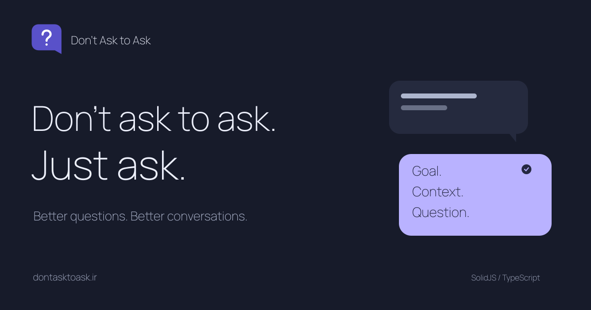

# Don't Ask to Ask

Practical, multilingual guides to asking clear questions, giving useful answers, sharing solutions, and choosing programming tools for the task.

**[Read the guides](https://dontasktoask.ir)** · **[فارسی](https://dontasktoask.ir/)** · **[English](https://dontasktoask.ir/en)**

## Guides

| Guide | Persian URL | English URL |
| --- | --- | --- |
| Just ask | `/` | `/en` |
| Hello, with a question | `/nohello` | `/en/nohello` |
| Explain the real problem | `/xy` | `/en/xy` |
| Ask in the open | `/nopv` | `/en/nopv` |
| Include code and errors | `/nocode` | `/en/nocode` |
| The best programming language | `/best-language` | `/en/best-language` |
| Write a useful bug report | `/bug-report` | `/en/bug-report` |
| Share what solved it | `/follow-up` | `/en/follow-up` |
| Help without belittling | `/answer` | `/en/answer` |
| Getting help with AI code | `/ai-help` | `/en/ai-help` |

## Languages

[فارسی](https://dontasktoask.ir/) · [English](https://dontasktoask.ir/en) · [Deutsch](https://dontasktoask.ir/de) · [Русский](https://dontasktoask.ir/ru) · [العربية](https://dontasktoask.ir/ar) · [Español](https://dontasktoask.ir/es) · [हिन्दी](https://dontasktoask.ir/hi) · [Türkçe](https://dontasktoask.ir/tr)

## Contributing

Corrections and translations are welcome. Guide text and project descriptions live in [`src/locales/`](src/locales/), with paths and source references in [`src/catalog.json`](src/catalog.json). Keep examples, explanations, checklists, and templates consistent across languages.

## Sources and credit

Inspired by [Don't Ask to Ask](https://dontasktoask.com/), [No Hello](https://nohello.net/), [The XY Problem](https://xyproblem.info/), and [Stack Overflow's minimal reproducible example guide](https://stackoverflow.com/help/minimal-reproducible-example). The language-choice guide builds on Erfan Mola's [TheBestLanguage](https://github.com/erfanmola/TheBestLanguage).

Created and maintained by **Erfan Mola**, part of **[Developix](https://developix.ir)**. The repository uses **[AGPL-3.0](LICENSE)**. Font licenses are included under `public/font-licenses/`.

---

## دربارهٔ پروژه

**نپرس که بپرسم، فقط بپرس** مجموعه‌ای از راهنماهای کوتاه برای پرسیدن سؤال روشن، پاسخ‌دادن محترمانه و به‌اشتراک‌گذاشتن راه‌حل‌هاست. هدف این راهنماها آسان‌ترکردن کمک‌گرفتن و کمک‌کردن است؛ نه سرزنش‌کردن تازه‌کارها.

راهنماها به فارسی، انگلیسی، آلمانی، روسی، عربی، اسپانیایی، هندی و ترکی در دسترس‌اند. برای اصلاح متن‌ها یا مشارکت در ترجمه، فایل‌های [`src/locales/`](src/locales/) را ویرایش کنید و درخواست تغییر بفرستید.
